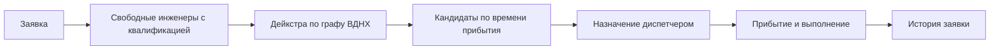
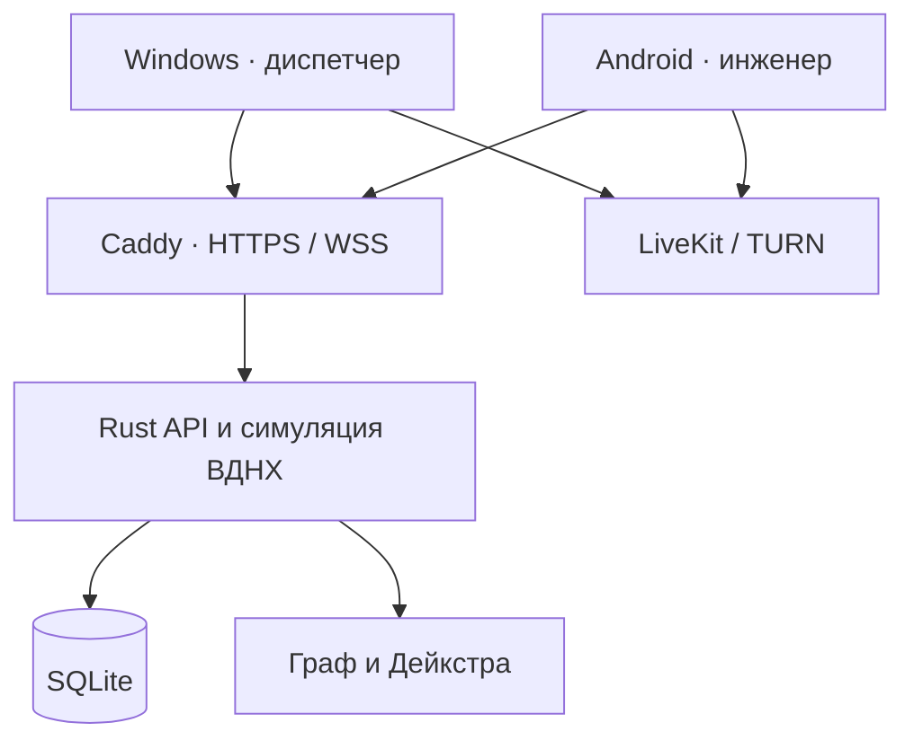

<div align="center">

# RampPulse
### Управление сменой на карте ВДНХ

Заявки, инженеры, спецтранспорт и воздушные суда в одной системе.


[Возможности](#возможности) · [Маршрутизация](#маршрутизация) · [Запуск](#запуск) · [Сборки](#сборки) · [Архитектура](#архитектура)

</div>

---

RampPulse помогает диспетчеру назначить на заявку свободного инженера с нужной квалификацией и доступным маршрутом. Инженер получает задание в мобильном приложении, передаёт геопозицию и отмечает этапы работы. Сервер хранит заявки и распространяет события смены между участниками.

Активный полигон — **ВДНХ**. Геометрия и стартовые объекты взяты из GeoJSON организаторов IT2026. Движение рассчитывает собственный сервер RampPulse.

## Возможности

| Диспетчер | Инженер |
| :--- | :--- |
| Карта смены, стоянки и борта | Личное задание и этапы выполнения |
| Создание заявок и назначение исполнителя | Передача геопозиции диспетчеру |
| Список подходящих специалистов с временем прибытия | Карта и маршрут к заданию |
| Перекрытие рёбер графа и пересчёт маршрута | Чат смены и звонки |
| Пауза и скорость симуляции | Профиль, аватар и баннер |
| Журнал событий и норматив 15 минут | Светлая и тёмные темы |

На полигоне заданы **10 воздушных судов, 7 стартовых баз инженеров, 3 машины и 10 зон обслуживания**. Число участников смены зависит от аккаунтов сервера. Погода загружается через Open-Meteo, голосовая связь использует LiveKit и TURN.

## Маршрутизация

Дорожная сеть ВДНХ представлена графом. Алгоритм Дейкстры ищет доступный маршрут с минимальным расчётным временем. Сервер учитывает перекрытия, промежуточные точки и возможность использовать транспорт.

Для заявки сервер отбирает инженеров с нужной квалификацией, активным аккаунтом и открытой сменой. Занятые специалисты и специалисты без доступного пути исключаются. Кандидаты сортируются по времени прибытия. Диспетчер подтверждает назначение, после чего сервер повторно проверяет доступность исполнителя.



## Запуск

Для разработки нужны Node.js с npm и Rust stable. Команды выполняются из корня репозитория.

```powershell
git clone https://github.com/TEXNOLONG/RampPulse.git
cd RampPulse
npm ci
npm --prefix web ci
```

В первом терминале запустите API. Деморежим создаёт тестовые аккаунты для локальной проверки.

```powershell
$env:HOST = "127.0.0.1"
$env:PORT = "18901"
$env:DEMO_MODE = "1"
cargo run --manifest-path rust-server/Cargo.toml
```

Во втором терминале запустите интерфейс.

```powershell
npm --prefix web run dev
```

Откройте `http://localhost:5173`. Vite передаёт API и WebSocket на локальный сервер. Демо-аккаунты доступны в метаданных `/api/meta` при включённом деморежиме.

## Сборки

### Windows

Потребуются Microsoft C++ Build Tools и WebView2 Runtime. Приложение использует Tauri и системный WebView2.

```powershell
npm run desktop:windows
```

Установщик создаётся в `src-tauri/target/release/bundle/nsis/`. Перед обновлением закройте приложение и работающий локальный `ramppulse-server.exe`, чтобы установщик мог заменить файлы.

### Android

Потребуются Android Studio, JDK, Android SDK и NDK. Укажите `JAVA_HOME`, `ANDROID_HOME` и `NDK_HOME` для своего окружения.

```powershell
rustup target add aarch64-linux-android
npm run android:prepare
npm run android:build
```

APK создаётся в `src-tauri/gen/android/app/build/outputs/apk/`. Обновления установленного приложения подписываются одним ключом. Ключи подписи хранятся вне репозитория.

В текущем Windows-окружении упаковка Android останавливается на создании символической ссылки. Для воспроизводимой сборки нужно настроить соответствующие права либо упаковать уже собранную библиотеку через Gradle.

### Linux

```bash
npm run desktop:linux
```

Системные зависимости Tauri устанавливаются для выбранного дистрибутива.

## Архитектура



Windows и Android подключаются к одному HTTPS API. Авторизация, состояние смены, маршруты и события WebSocket обслуживаются Rust-сервером. Caddy обеспечивает HTTPS. Для звонков отдельно настраиваются LiveKit и TURN.

| Каталог | Назначение |
| :--- | :--- |
| `web/` | React, TypeScript, карта и интерфейсы ролей |
| `rust-core/` | Граф и расчёт маршрутов |
| `rust-server/` | API, аккаунты, заявки, симуляция и WebSocket |
| `src-tauri/` | Приложения Windows, Linux и Android |
| `data/` | Граф ВДНХ и данные смены |
| `tools/` | Подготовка геоданных и сборок |
| `deploy/` | Развёртывание сервера |
| `docs/` | Технические заметки и сверка с заданием |

## Развёртывание и документация

Сценарии в `deploy/` и корневые скрипты CORS содержат параметры текущего тестового VPS. Перед использованием на своём сервере проверьте адрес, пути и имя службы. Ключи сервисов задавайте в серверном окружении.

- [Развёртывание VPS](DEPLOY-VPS-UBUNTU.md)
- [Настройка TURN](deploy/COTURN.md)
- [Фоновая работа Android](deploy/ANDROID-BACKGROUND.md)
- [Карта и геоданные](docs/MAPS.md)
- [Погода](docs/WEATHER.md)
- [Сверка с заданием](docs/Сверка-с-ТЗ.md)

## Проверка исходников

```powershell
npm run ui:build
cargo check --manifest-path rust-server/Cargo.toml
```

Проект находится в активной разработке. Спецтранспорт пока закреплён за тремя инженерами. Полный сценарий смены, GPS на устройстве и звонки проверяются отдельно от компиляции. Исторические документы могут описывать более ранние версии.

## Лицензия

Исходный код распространяется по [MIT](LICENSE). Геоданные и сторонние материалы сохраняют условия своих правообладателей.
