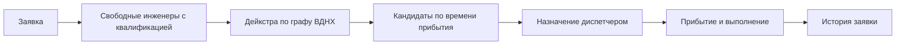
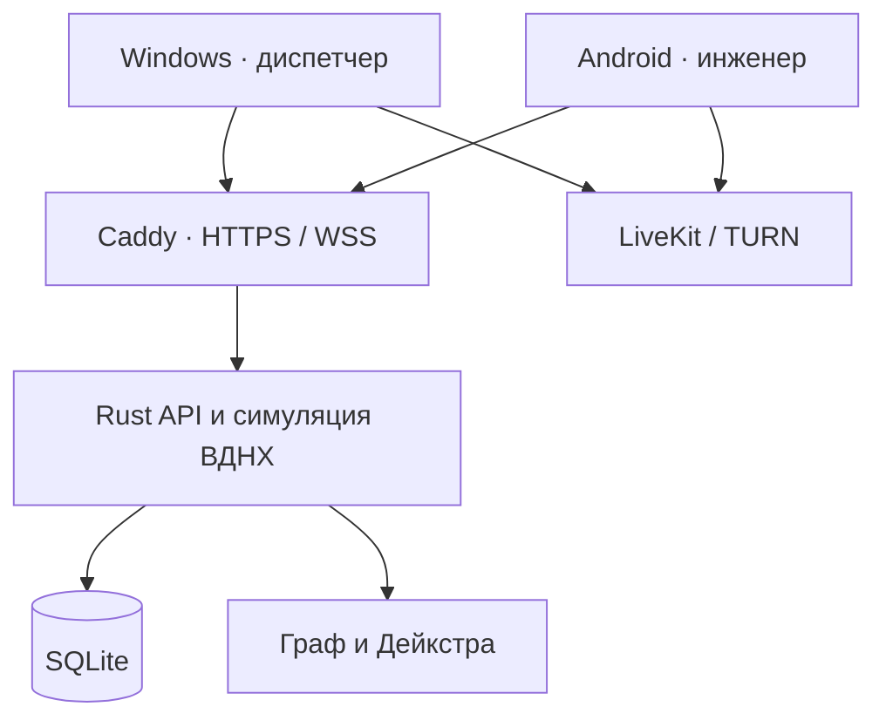

<div align="center">

# RampPulse
### Управление сменой на карте ВДНХ

Заявки, инженеры, спецтранспорт и воздушные суда в одной системе.


[Возможности](#возможности) · [Маршрутизация](#маршрутизация) · [Симуляция](#симуляция) · [Проверка смены](#проверка-смены) · [Запуск](#запуск) · [Сборки](#сборки) · [Архитектура](#архитектура)

</div>

---

RampPulse помогает диспетчеру назначить на заявку свободного инженера с нужной квалификацией и доступным маршрутом. Инженер получает задание в мобильном приложении, передаёт геопозицию и отмечает этапы работы. Сервер хранит заявки и распространяет события смены между участниками.

Активный полигон — **ВДНХ**. Геометрия и стартовые объекты взяты из GeoJSON организаторов IT2026. Движение рассчитывает собственный сервер RampPulse.

## Скачать приложения

**Последний выпуск: [GitHub Releases](https://github.com/TEXNOLONG/RampPulse/releases/latest).**

| Платформа | Файл | Примечание |
| :--- | :--- | :--- |
| Windows x64 | [Установщик EXE](https://github.com/TEXNOLONG/RampPulse/releases/latest/download/RampPulse-Windows-x64-setup.exe) | Требуется WebView2; закройте старое приложение перед установкой |
| Android ARM64 | [APK инженера](https://github.com/TEXNOLONG/RampPulse/releases/latest/download/RampPulse-Android-arm64.apk) | Подписанная сборка; разрешите установку из выбранного источника |

Оба приложения подключаются к одному HTTPS API. Серверные ключи и APK-ключ подписи в репозиторий не включены. Контрольные суммы установщиков приложены к выпуску в `SHA256SUMS.txt`.

## Что нового в 0.6.22

- Промежуточные точки выбираются кликами по карте, нумеруются и меняются местами без ввода кодов узлов.
- Движение и ETA учитывают максимальную разрешённую скорость каждого участка; скорость и лимит видны инженеру и диспетчеру.
- Инженер может отказаться до начала работ с обязательной причиной; заявка возвращается диспетчеру, причина попадает в журнал и общий канал.
- Прибытие по GPS или в конце модельного маршрута автоматически запускает работу; ручные кнопки прибытия и старта убраны.
- Таймер прибытия останавливается и подписывается «Прибыл за»; длительность сохраняется отдельно от текущего ускорения симуляции.
- Исправлена загрузка состояния инженера после добавления поля времени прибытия.
- Убрано сравнение «Человек vs система», панель симуляции стала компактнее.

## Возможности

| Диспетчер | Инженер |
| :--- | :--- |
| Карта смены, стоянки и борта | Личное задание и этапы выполнения |
| Создание заявок и назначение исполнителя | Передача геопозиции диспетчеру |
| Список подходящих специалистов с временем прибытия | Карта и маршрут к заданию |
| Перекрытие рёбер графа и пересчёт маршрута | Чат смены и звонки |
| Размещение у терминала, пауза и ускорение ×1–×50 | Текстовый навигатор: повороты, расстояние и ETA |
| Журнал и экспорт CSV | Профиль, аватар и баннер |
| Журнал событий и норматив 15 минут | Светлая и тёмные темы |

На полигоне заданы **10 воздушных судов, 7 стартовых баз инженеров, 3 машины и 10 зон обслуживания**. Число участников смены зависит от аккаунтов сервера. Погода загружается через Open-Meteo, голосовая связь использует LiveKit и TURN.

## Маршрутизация

Дорожная сеть ВДНХ представлена графом. Алгоритм Дейкстры ищет доступный маршрут с минимальным расчётным временем. Сервер учитывает перекрытия, промежуточные точки и возможность использовать транспорт.

Для заявки сервер отбирает инженеров с нужной квалификацией, активным аккаунтом и открытой сменой. Занятые специалисты и специалисты без доступного пути исключаются. Кандидаты сортируются по времени прибытия. Диспетчер подтверждает назначение, после чего сервер повторно проверяет доступность исполнителя.



## Симуляция

Симуляцией управляет диспетчер, движение рассчитывает VPS. Все подключённые клиенты получают координаты из одной модели.

1. Нажмите **«У терминала»** — техники без активного маршрута размещаются в узле дорожной сети у терминала, симуляция ставится на паузу.
2. Создайте заявку и назначьте инженера с подходящей квалификацией.
3. Нажмите **«Симуляция»** и выберите ускорение: ×1, ×2, ×5, ×10, ×20 или ×50.
4. Наблюдайте движение по рассчитанному маршруту и изменение ETA. Без назначения техники остаются на месте.

Сервер сравнивает пеший и транспортный варианты по времени, включая добавочное время посадки. Доступность машин в симуляции пока упрощена: полноценного распределения конкретных машин между всеми инженерами нет.

В APK инженера подсказки появляются в задании и на карте: «Через 50 м поверните направо», оставшееся расстояние, ETA и способ передвижения. Расчёт следующего манёвра учитывает продвижение по маршруту. Озвучивание пока не реализовано.

## Проверка смены

Для совместной проверки нужны Windows-клиент диспетчера и APK инженера, подключённые к одному HTTPS API. Войдите на телефоне в аккаунт того инженера, которому будет назначена заявка, и откройте его смену.

| Шаг | Диспетчер | Инженер |
| :--- | :--- | :--- |
| Подготовка | Разместить техников у терминала | Открыть смену |
| Заявка | Создать заявку в другой зоне, выбрать исполнителя | Получить сообщение о назначении |
| Движение | Включить симуляцию, наблюдать маркер | Открыть карту, проверить маршрут и подсказки |
| Работа | Контролировать состояние заявки | Дождаться автоматического начала работы, отметить выполнение |
| Проверка | Открыть журнал и выгрузить CSV | Проверить освобождение после завершения |

Назначение сейчас сразу переводит заявку в состояние «в пути». До начала работ инженер может отказаться с обязательной причиной: заявка возвращается диспетчеру, маршрут останавливается, причина сохраняется в журнале и общем канале, исходное время заявки не обнуляется. После начала работ самостоятельный отказ запрещён. Прибытие и начало работы фиксируются автоматически по GPS или в конце модельного маршрута; ручное подтверждение не требуется. Отдельное подтверждение приёма заявки ещё требует доработки под конкурсное ТЗ. Реальный GPS проверяется отдельным прогоном без модельного движения.

## Запуск

Для разработки нужны Node.js с npm и Rust stable. Команды выполняются из корня репозитория.

```powershell
git clone https://github.com/TEXNOLONG/RampPulse.git
cd RampPulse
npm ci
npm --prefix web ci
```

В первом терминале запустите API. Деморежим создаёт тестовые аккаунты для локальной проверки.

```powershell
$env:HOST = "127.0.0.1"
$env:PORT = "18901"
$env:DEMO_MODE = "1"
cargo run --manifest-path rust-server/Cargo.toml
```

Во втором терминале запустите интерфейс.

```powershell
npm --prefix web run dev
```

Откройте `http://localhost:5173`. Vite передаёт API и WebSocket на локальный сервер. Демо-аккаунты доступны в метаданных `/api/meta` при включённом деморежиме.

## Сборки

### Windows

Потребуются Microsoft C++ Build Tools и WebView2 Runtime. Приложение использует Tauri и системный WebView2.

```powershell
npm run desktop:windows
```

Установщик создаётся в `src-tauri/target/release/bundle/nsis/`. Перед обновлением закройте приложение и работающий локальный `ramppulse-server.exe`, чтобы установщик мог заменить файлы.

### Android

Потребуются Android Studio, JDK, Android SDK и NDK. Укажите `JAVA_HOME`, `ANDROID_HOME` и `NDK_HOME` для своего окружения.

```powershell
rustup target add aarch64-linux-android
npm run android:prepare
npm run android:build
```

APK создаётся в `src-tauri/gen/android/app/build/outputs/apk/`. Обновления установленного приложения подписываются одним ключом. Ключи подписи хранятся вне репозитория.

Если Windows запрещает создание символической ссылки, после успешной компиляции Rust можно скопировать библиотеку и завершить упаковку через Gradle. Команды PowerShell из корня проекта:

```powershell
Copy-Item src-tauri/target/aarch64-linux-android/release/libramppulse_lib.so src-tauri/gen/android/app/src/main/jniLibs/arm64-v8a/libramppulse_lib.so -Force
Push-Location src-tauri/gen/android
.\gradlew.bat :app:assembleArm64Release -x rustBuildArm64Release
Pop-Location
```

Полученный release APK необходимо выровнять через `zipalign` и подписать через `apksigner` своим постоянным ключом. Для получения фоновых push-уведомлений дополнительно настраивается FCM; открытый интерфейс получает события через WebSocket и резервное обновление состояния.

### Linux

```bash
npm run desktop:linux
```

Системные зависимости Tauri устанавливаются для выбранного дистрибутива.

## Архитектура



Windows и Android подключаются к одному HTTPS API. Авторизация, состояние смены, маршруты и события WebSocket обслуживаются Rust-сервером. Caddy обеспечивает HTTPS. Для звонков отдельно настраиваются LiveKit и TURN.

Интерфейс встроен в приложения. Обновление VPS не обновляет установленный `.exe` или APK: после изменений клиента требуется новая сборка. Готовые установщики, APK, локальные базы, ключи подписи и секреты не входят в исходный репозиторий.

| Каталог | Назначение |
| :--- | :--- |
| `web/` | React, TypeScript, карта и интерфейсы ролей |
| `rust-core/` | Граф и расчёт маршрутов |
| `rust-server/` | API, аккаунты, заявки, симуляция и WebSocket |
| `src-tauri/` | Приложения Windows, Linux и Android |
| `data/` | Граф ВДНХ и данные смены |
| `tools/` | Подготовка геоданных и сборок |
| `deploy/` | Развёртывание сервера |
| `docs/` | Технические заметки и сверка с заданием |

## Развёртывание и документация

Сценарии в `deploy/` и корневые скрипты CORS содержат параметры текущего тестового VPS. Перед использованием на своём сервере проверьте адрес, пути и имя службы. Ключи сервисов задавайте в серверном окружении.

- [Развёртывание VPS](DEPLOY-VPS-UBUNTU.md)
- [Настройка TURN](deploy/COTURN.md)
- [Фоновая работа Android](deploy/ANDROID-BACKGROUND.md)
- [Карта и геоданные](docs/MAPS.md)
- [Погода](docs/WEATHER.md)
- [Сверка с заданием](docs/Сверка-с-ТЗ.md)

Скрипт `deploy/update-vdnh.ps1` собирает интерфейс, загружает исходники на тестовый VPS и запускает серверную сборку отдельной задачей systemd. Перед заменой сохраняются сервер и frontend; при ошибке перезапуска или проверки здоровья предусмотрен откат. Резервное копирование базы необходимо организовать отдельно.

## Проверка исходников

```powershell
npm run ui:build
cargo check --manifest-path rust-server/Cargo.toml
cargo test --manifest-path rust-server/Cargo.toml
cargo test --manifest-path rust-core/Cargo.toml
```

## Состояние проекта

Подтверждены сборки Windows и Android, движение назначенного инженера на VPS и проверки расчёта навигационных подсказок. Последние изменения перечислены в разделе «Что нового в 0.6.22». На VPS проверены движение, автоматическое начало работы после доезда, отказ инженера, стабильность длительности прибытия и загрузка состояния обеих ролей.

Перед использованием на испытаниях необходимо завершить или проверить:

- полный прогон Windows ↔ Android, включая GPS на устройстве, прибытие и журнал;
- непрерывный GPS при выключенном экране, FCM и звонки между устройствами;
- распределение конкретных машин и единое время симуляции;
- AOG, MEL, допуски ATA, конкурирующие срочные заявки и предупреждения диспетчеру с вариантом решения;
- полноту аудита и соответствие API геопозиций контракту организаторов.

Собственный приёмник `/api/agents/positions` уже есть, но его формат и применение данных ко всем агентам ещё требуют доработки. Полноценная офлайн-очередь действий не реализована. Исторические документы могут описывать более ранние версии.

## Лицензия

Исходный код распространяется по [MIT](LICENSE). Геоданные и сторонние материалы сохраняют условия своих правообладателей.
